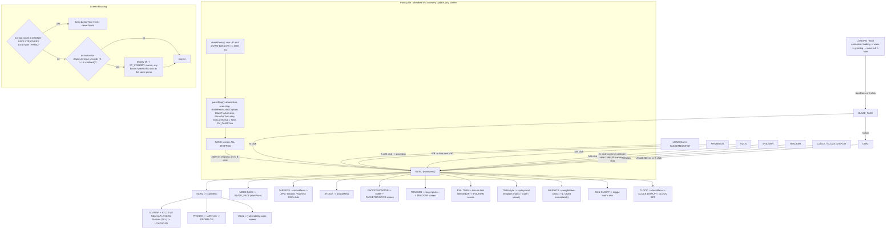
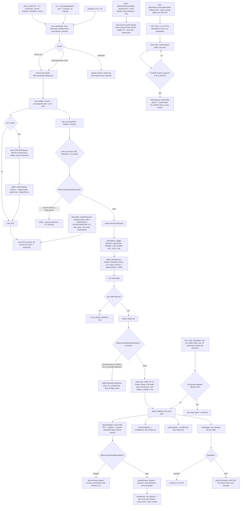
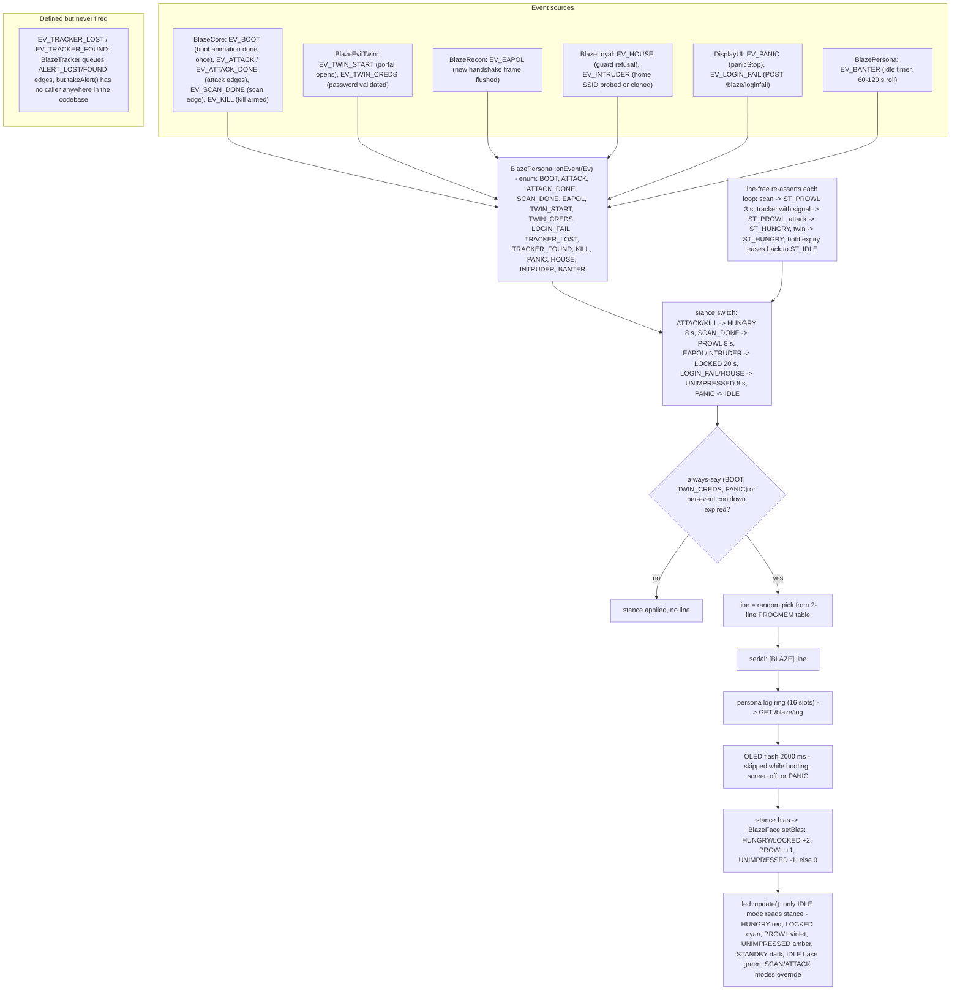
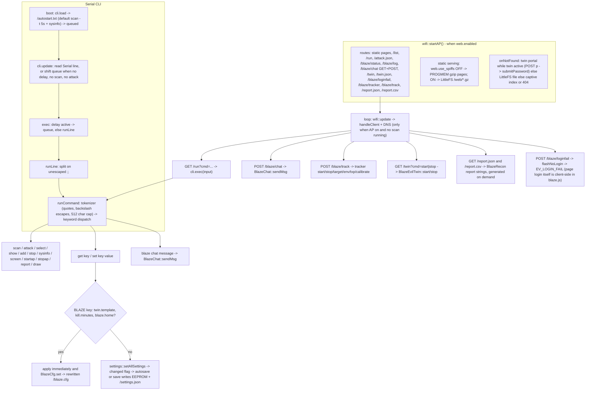

# BLAZE — Full Project Flowchart

**Reading guide.** Every arrow means "then / calls": following an arrow is what the firmware does next, in order. Decisions are drawn as `{}`-braced nodes — exactly one outgoing edge is taken per pass. **Panic overrides everything**: `DisplayUI::update()` checks the UP+DOWN hold before any button handling or drawing, and `panicStop()` halts attack, scan, EAPOL capture, tracker, twin and the KILL/KICK flags on the spot, on any screen. This is a text-only project — every companion output described below is text (OLED strings, serial lines, JSON/log endpoints); no audio path exists anywhere in the codebase. All facts were traced from the sources in this repo (`.ino`, `BlazeCore`, `DisplayUI`, `Attack`, `Scan`, `CLI`, `wifi`, `Blaze*` modules, `led`, `data/web`).

---

## 1. Boot flow — cold start

```mermaid
flowchart TD
    S["setup() entry"] --> RS["randomSeed(os_random())"]
    RS --> SB["Serial.begin(115200)"]
    SB --> FS["LittleFS.begin()"]
    FS --> EEB["EEPROMHelper.begin(EEPROM_SIZE)"]
    EEB --> BC{"boot counter valid?"}
    BC -->|no| FMT["format LittleFS + EEPROM, reset boot counter"]
    FMT --> TM["currentTime = millis()"]
    BC -->|yes| TM
    TM --> SL["settings::load() - EEPROM object, magic check, else reset; then save()"]
    SL --> FIX["force display enabled; migrate legacy AP identity to BLAZE defaults"]
    FIX --> WB["wifi::begin() - radio hardening (no sleep, no autoconnect, STA mode, MACs); copy web files to /web when web.use_spiffs"]
    WB --> CB["register promiscuous RX callback -> scan.sniffer"]
    CB --> DS["displayUI.setup() - OLED init, button pins UP/DOWN/A/B, all menus built"]
    DS --> C1["BlazeCore.setup(): Tracker -> Fx -> Persona -> Chat -> EvilTwin -> Recon -> Loyal -> Face.loadWeights"]
    C1 --> C2{"display enabled?"}
    C2 -->|yes| C3["BlazeFace.beginLoading(); displayUI.mode = LOADING"]
    C2 -->|no| C4["skip boot animation"]
    C3 --> LD
    C4 --> LD
    LD["names.load() (/names.json) + ssids.load() (/ssids.json)"]
    LD --> CL["cli.load(): create /autostart.txt if missing (scan -t 5s + sysinfo), queue its lines"]
    CL --> SS["scan.setup(): save(true) creates /scan.json - results are NOT loaded, lists start empty"]
    SS --> CE{"CLI enabled in settings?"}
    CE -->|yes| CE1["cli.enable()"]
    CE -->|no| CE2["Serial end"]
    CE1 --> WE
    CE2 --> WE{"web enabled in settings?"}
    WE -->|yes| WA["wifi::startAP(): softAP BLAZE + DNS captive portal + mDNS + HTTP routes + server.begin"]
    WE -->|no| WN["skip AP"]
    WA --> ST
    WN --> ST["print STARTED + version"]
    ST --> LS["led::setup()"]
    LS --> RB["resetButton = ButtonPullup(RESET_BUTTON)"]
    RB --> L["enter loop()"]
```



*Caption:* `setup()` runs strictly in the order shown — serial/FS/EEPROM first, then settings (EEPROM-backed, mirrored to `/settings.json`), radio config, OLED + menus, `BlazeCore::setup()` (which ends with `beginLoading()` and `mode = LOADING`), then names/ssids/CLI-autostart/scan-file, and only finally `led::setup()`. Note two deliberate corrections to common assumptions: `wifi::begin()` only configures the radio (the AP + mDNS come later in `wifi::startAP()`), and `/scan.json` is *created* at boot, never read back.

## 2. Main loop — one pass

```mermaid
flowchart TD
    L["loop() pass"] --> TM["currentTime = millis()"]
    TM --> LEDU["led::update(): OFF / SCAN / ATTACK / IDLE; IDLE mode yields color to stance"]
    LEDU --> WU["wifi::update()"]
    WU --> WQ{"AP on and not scanning?"}
    WQ -->|yes| WH["server.handleClient() + dns.processNextRequest()"]
    WQ -->|no| ATK
    WH --> ATK["attack.update()"]
    ATK --> AQ{"running and not scanning?"}
    AQ -->|yes| AR["deauthUpdate / deauthAllUpdate / beaconUpdate / probeUpdate / csaUpdate"]
    AR --> A1{"1 s tick?"}
    A1 -->|yes| A2["updateCounter: {attacktimeout reached} -> stop; recompute per-second rates; status line; new random MAC"]
    A1 -->|no| CORE
    A2 --> CORE
    AQ -->|no| CORE
    CORE["BlazeCore.update()"] --> F["BlazeFace::update() - boot phases, reactions, flash overlay"]
    F --> TR["BlazeTracker::update() - EMA/distance/lost edges (alert queue)"]
    TR --> PE["BlazePersona::update() - idle-banter timer (60-120 s) + stance hold decay"]
    PE --> ET["BlazeEvilTwin::update() - ST_HUNGRY poke, 5 min timeout, password validation"]
    ET --> RC["BlazeRecon::update() - pcap flush, EV_EAPOL edge, CAP_KICK/CAP_REC machine"]
    RC --> LO["BlazeLoyal::update() - probe edge + 2 s clone/selection sweep"]
    LO --> BE{"face boot done and EV_BOOT not yet sent?"}
    BE -->|yes| BE1["BlazePersona::onEvent(EV_BOOT) once"]
    BE -->|no| PK
    BE1 --> PK
    PK["line-free pokes: scanning -> ST_PROWL 3 s; tracker with signal -> ST_PROWL; attack running -> ST_HUNGRY"]
    PK --> AE{"attack running edge?"}
    AE -->|just started| AE1["EV_ATTACK"]
    AE -->|just stopped| AE2["EV_ATTACK_DONE + glitch burst"]
    AE -->|no edge| KE
    AE1 --> KE
    AE2 --> KE
    KE{"KILL armed?"}
    KE -->|just armed| KE1["EV_KILL + record killStart"]
    KE1 --> KE2{"kill.minutes elapsed (default 5, min 1)?"}
    KE2 -->|yes| KE3["auto-stop attack - a forgotten flood cannot run forever"]
    KE2 -->|no| SE
    KE -->|not kill| SE
    KE3 --> SE
    SE{"scan just stopped after running?"}
    SE -->|yes| SE1["EV_SCAN_DONE"]
    SE -->|no| DUI
    SE1 --> DUI
    DUI["displayUI.update()"] --> P{"UP+DOWN both LOW for 1500 ms?"}
    P -->|yes| PAN["panicStop() - see diagram 3"]
    P -->|no| BTN["up/down/a/b button events (click + hold handlers)"]
    BTN --> DR["draw() by mode - menu (matrix rain when on), face, chat, tracker, twin, panic; glitch overlay on top"]
    DR --> EX{"LOADING / FACE / TRACKER / EVILTWIN / PANIC?"}
    EX -->|yes| KP["refresh buttonTime - these screens never blank"]
    EX -->|no| BL{"display.timeout elapsed since last button?"}
    BL -->|yes| OFF["display off -> BlazePersona::onStandby -> ST_STANDBY"]
    BL -->|no| CLIU
    KP --> CLIU
    OFF --> CLIU
    CLIU["cli.update(): Serial line, or shift queued command when idle (no delay/scan/attack)"]
    CLIU --> SCU["scan.update(): progress, channel hop, continue timer"]
    SCU --> SSU["ssids.update(): random SSID mode if enabled"]
    SSU --> AS{"autosave enabled and interval passed?"}
    AS -->|yes| AS1["names.save + ssids.save + settings.save (EEPROM + /settings.json)"]
    AS -->|no| FB
    AS1 --> FB
    FB{"first loop pass?"}
    FB -->|yes| FB1["reset boot counter; setupLED when HIGHLIGHT_LED"]
    FB -->|no| RST
    FB1 --> RST
    RST["resetButton.update(): {held 5 s} -> RESETTING screen, settings reset + save, 2 s delay, restore mode"]
    RST --> L
```



*Caption:* This is the exact `loop()` order from `ESP8266_Deauther_SSD1306.ino` — LED, Wi-Fi/web, attack, `BlazeCore::update()` (which internally ticks face, tracker, persona, twin, recon, loyal plus all persona edges), display, CLI, scan, ssids, autosave, boot-counter, reset button. Tracker/twin/recon never run directly in `loop()`; they are reached through `BlazeCore::update()`.

## 3. Display mode machine — screens, panic, blanking



*Caption:* The BLAZE screens cycle `LOADING → FACE → CHAT → MENU` via A click / A hold (800 ms) / B, and the `MODE FACE` menu entry re-enters the face from the menu. `panicStop()` stops exactly the six things listed (attack, scan, EAPOL capture, tracker, twin, KILL/KICK flag), holds the PANIC screen 2.5 s, then drops to the main menu with cursor reset. Exempt screens never blank; everything else sleeps after the display timeout and wakes with `onStandby(false)` → `ST_IDLE`.

## 4. Scan & attack pipeline



*Caption:* Scans feed the lists, selections pass the OwnNetGuard gate, and `Attack::start()` re-checks everything through `allowAttack()` before the radio ever transmits. Outgoing frames are guarded a third time by `blockMac()` inside `deauthDevice()`/`csaUpdate()`. Runs end via `attacktimeout` (per-attack), the `kill.minutes` hard cap (KILL only), the 4 s/45 s CAP phases, the 5 min twin timeout, or panic.

## 5. Persona event system



*Caption:* Every source feeds one `onEvent()` pipeline: stance first (with hold + face bias), then a cooldown check (0 ms for BOOT/TWIN_CREDS/PANIC; e.g. 6 s attack, 8 s scan-done, 15 s EAPOL, 5 s house, 30 s intruder), then one random PROGMEM line pushed to serial, the 16-slot `/blaze/log` ring and a 2 s face flash. Cooldowns only mute the *line* — the stance still applies. The LED mirrors the stance only while `led::update()` selects IDLE mode.

## 6. Loyalty guards — four layers

```mermaid
flowchart TD
    subgraph L1 ["Layer 1 - selection guards"]
        A1["Accesspoints.select / selectAll; Stations.select / selectAll"] --> A2{"allowSelect(ssid)"}
        A2 -->|own AP SSID or blaze.home| A3["trip(): guard serial line + EV_HOUSE, nothing selected"]
        A2 -->|free| A4["target starred"]
    end
    subgraph L2 ["Layer 2 - Attack::start safety net"]
        B1["Attack::start(flags)"] --> B2{"allowAttack(beacon or probe)?"}
        B2 -->|protected name inside SSIDs list| B3["trip + refuse"]
        B2 -->|protected entry still selected| B4["dropProtected() deselects all three lists, trip + refuse"]
        B3 --> B5["flags cleared (deauth/beacon/probe/csa/deauthAll = false) - nothing starts"]
        B4 --> B5
        B2 -->|clean| B6["attack runs"]
    end
    subgraph L3 ["Layer 3 - packet-level blockMac"]
        C1["deauthDevice(apMac) and csaUpdate round-robin"] --> C2{"blockMac(mac): own softAP MAC or home BSSID?"}
        C2 -->|hit| C3["frame suppressed, returns handled so target rotation keeps moving; refusal flash at most every 5 s -> EV_HOUSE"]
        C2 -->|miss| C4["frame transmitted"]
    end
    subgraph L4 ["Layer 4 - BlazeLoyal::update sweep + IntruderAlert"]
        D1["probe log edge: probeTotal rose since last check -> parse newest lines -> SSID equals blaze.home? -> fireIntruder"]
        D2["every 2 s: dropProtected() sweep - protected targets can never stay selected -> trip"]
        D3["every 2 s: home clone check - same SSID, different BSSID -> fireIntruder"]
        D1 --> F{"fireIntruder gates: watch armed (home set and not our own AP), attack not running, 30 s cooldown"}
        D3 --> F
        F -->|all pass| F1["EV_INTRUDER (LOCKED stance line)"]
        F -->|any blocked| F2["silent"]
        D2 --> F2
    end
```



*Caption:* Four independent layers protect own/home networks: select-time refusal, start-time safety net (drop + refuse), per-frame `blockMac()`, and a 2 s sweep that deselects anything protected that slipped through. IntruderAlert runs inside the same 2 s tick plus a probe-log edge, and only ever fires while idle with a 30 s cooldown. Every refusal emits the `[BLAZE] own-net guard` serial line and an `EV_HOUSE` persona reaction.

## 7. CHAT flow

```mermaid
sequenceDiagram
    participant BTN as Buttons UP/DOWN/A
    participant WEB as POST /blaze/chat
    participant CL as CLI blaze chat
    participant CH as BlazeChat
    participant BR as Offline brain
    participant OUT as OLED / serial / chat log

    Note over CH: 8 canned wheel phrases, 40 char cap
    BTN->>CH: UP / DOWN -> move(-1 / +1) scrolls the wheel
    BTN->>CH: A click -> send() -> sendMsg(highlighted phrase), wheel advances
    WEB->>CH: JSON msg -> sendMsg(msg), replies with ok + reply
    CL->>CH: blaze chat text... -> sendMsg, prints blaze + reply
    CH->>CH: trim, cap at 40 chars, lowercase
    CH->>BR: brain(lower)
    BR-->>CH: exact greetings and filler (hi/hey/hello/yo/sup, ok/k/lol)
    BR-->>CH: query answers: status, report, uptime, stance, see, help
    BR-->>CH: keyword RULES (roast, hack, deauth, attack, kill, password, wifi, ...)
    BR-->>CH: otherwise random DEFAULTS (4 lines)
    CH->>OUT: logPush you + blaze entries (8 slot ring -> GET /blaze/chat)
    CH->>OUT: serial [CHAT] message -> reply
    alt mode is CHAT or PANIC
        CH->>OUT: no face flash (CHAT renders inline, PANIC wins)
    else any other mode
        CH->>OUT: flashMsg(message + reply, 2500 ms) over the face
    end
    Note over CH: render() only while mode = CHAT; idle-banter skips CHAT and PANIC
```

*Caption:* Three entry points (buttons phrase wheel, web `POST /blaze/chat`, CLI `blaze chat`) all converge on `BlazeChat::sendMsg()` with its 40-char cap and offline brain. Query answers are computed live (`status` = scan/attack/twin/stance, `report` = AP count + uptime, `uptime`, `stance`, `see` = AP count, `help`); everything else falls through keyword rules to random defaults. Chat keeps its own 8-slot ring served at `/blaze/chat` — separate from the persona `/blaze/log` ring — and never flashes over CHAT or PANIC screens.

## 8. Web & CLI surface



*Caption:* The web layer is a thin shell over the same engines the menus use — `/run` and `POST /blaze/chat` literally call into `cli.exec()` / `BlazeChat::sendMsg()`, and unknown URLs are first claimed by the evil-twin portal when it is active. The CLI parses each line with a quote-aware tokenizer and dispatches to commands; `set` on a BLAZE key persists instantly to `/blaze.cfg`, while ordinary keys go through the deauther settings blob (EEPROM, JSON mirror). The static page mode flips on `web.use_spiffs`: PROGMEM gzip routes when off, LittleFS `/web` files when on.

## 9. Persistence map

| Path | Holds | Written by | Read by |
|---|---|---|---|
| EEPROM (`SETTINGS_ADDR`) | settings blob (magic-checked struct) | `settings::save()` — autosave in `loop()`, CLI `save`/`set`, after boot `load()` | `settings::load()` at boot (falls back to `reset()` on bad magic) |
| `/settings.json` | human-readable JSON mirror of the blob | `settings::save()` (same calls as EEPROM) | **not read by firmware** — export only |
| `/blaze.cfg` | `key=value` lines: `twin.template`, `kill.minutes`, `blaze.home`, `face.weights` (CSV), `rain`, `txp`, `env` | `BlazeCfg::set` via CLI `set twin.template/kill.minutes`, `BlazeLoyal::setHome`, `BlazeFace::saveWeights` (WEIGHTS menu), `BlazeFx::toggleRain`, `BlazeTracker::setTxPower/setEnvName` (POST `/blaze/track`) | `BlazeEvilTwin::templateId`, `BlazeCore` (kill.minutes), `BlazeLoyal::setup`, `BlazeFace::loadWeights` (boot), `BlazeFx::setup`, `BlazeTracker::setup` |
| `/scan.json` | scan results snapshot (APs / stations / SSIDs) | `Scan::save()` — created by `scan.setup()` at boot, rewritten on every scan stop | **never read back** — lists start empty each boot |
| `/ssids.json` | SSID list (beacon/probe payloads) | `ssids.save()` — autosave, menu clone/remove, CLI `save` | `ssids.load()` at boot |
| `/names.json` | saved names list | `names.save()` — autosave, CLI `save` | `names.load()` at boot |
| `/autostart.txt` | boot CLI script | created with default `scan -t 5s` + `sysinfo` by `cli.load()` (`checkFile`) if missing | `execFile()` at boot — lines queued, drained by `cli.update()` when idle |
| `/eapol.pcap` | captured EAPOL handshake (pcap, DLT 105) | `BlazeRecon::flushEapol()` append during CAP_REC / stop | external tools only (HTTP `?download` via `handleFileRead`) — never parsed on device |
| `/report.json`, `/report.csv` | **not files** — vulnerability report generated on demand | `GET /report.json`, `GET /report.csv`, CLI `report [csv]` | — (strings only, nothing stored) |
| LittleFS `/web/*.gz` | web UI assets | `copyWebFiles()` at boot when `web.use_spiffs` is on (extracted from PROGMEM) | `handleFileRead()` when `web.use_spiffs` is on |
| `/portal.html` | optional evil-twin portal override (`%SSID%` placeholder) | user-provided | `BlazeEvilTwin::portalHtml()` — else built-in template 0/1/2 |
| `data/web/*` (repo) | web UI sources | dev-time only — compiled into PROGMEM by `webfiles.h` | served by PROGMEM routes when `use_spiffs` is off |

*Note:* the persona log (`/blaze/log`) and chat log (`/blaze/chat`) are RAM ring buffers, not files — they reset on reboot. Settings mutations from `set` are deferred (saved by autosave/`save`), while every BLAZE-key `set` rewrites `/blaze.cfg` immediately.
