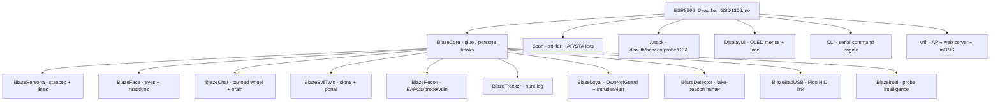

# 🔥 BLAZE-deauther

<div align="center">

```
   ██████╗ ██╗     █████╗ ███████╗███████╗
   ██╔══██╗██║     ██╔══██╗╚══███╔╝██╔════╝
   ██████╔╝██║     ███████║  ███╔╝ █████╗
   ██╔══██╗██║     ██╔══██║ ███╔╝  ██╔══╝
   ██████╔╝███████╗██║  ██║███████╗███████╗
   ╚═════╝ ╚══════╝╚═╝  ╚═╝╚══════╝╚══════╝
```

**A hacking device with a partner riding shotgun.**

[](https://github.com/Darksivatamil/BLAZE-deauther)
[](LICENSE)
[]()
[]()
[]()
[]()

> ⚠️ **AUTHORIZED TESTING ONLY.** Every frame carries your radio's identity.
> Run BLAZE only on networks and clients you own, or on systems you have
> explicit written permission to test. Unauthorized use is a crime in most
> jurisdictions. BLAZE will not argue with your lawyer for you.

</div>

---

## 🧠 What is BLAZE?

**BLAZE** is a hardened ESP8266 Wi-Fi attack platform built on top of the
legendary [esp8266_deauther](https://github.com/spacehuhntech/esp8266_deauther),
re-skinned and supercharged by **Team DARK** into a full **hacking companion**.

It is not "a deauther with a face on it" — it is a **device** (deauth, CSA,
Kick-and-Lure, Evil Twin, probe intelligence, vuln reporting, panic button)
plus a **companion** (an offline personality that narrates what it sees,
celebrates catches, warns you, roasts you, and refuses dumb orders).

All companion output is **text only** — OLED strings, serial lines, JSON/log
endpoints. No audio. No cloud. No AI uplink. Fully offline brain.

---

## ⚡ Feature Matrix

| Category | Capability |
|---|---|
| 🔫 **Attacks** | Burst-scheduled deauth, deauth-all, beacon flood, probe flood, CSA (Channel Switch Announcement), Kick-and-Lure |
| 👿 **Evil Twin** | 3 portal templates (matrix / router / venue / google), `%SSID%` override via `/portal.html`, Kick-and-Lure clone |
| 🕵️ **Recon** | EAPOL handshake capture (pcap, DLT 105), probe-request log, PNL harvest, hidden-SSID unmasker, victim ID, forensics timeline |
| 🎯 **Detector** | Evidence-graded deauther / fake-beacon hunter, `all / duel / rival` filters, active probe verification |
| 🛡️ **Loyalty** | OwnNetGuard refuses attacks on your own SSID, IntruderAlert on home-SSID probes |
| 🦆 **BadUSB** | External Raspberry Pi Pico HID link (UART1), NORMAL / CRITICAL / EXIT menu, ACK watchdog |
| 🧠 **Companion** | 4 stances (IDLE / HUNT / COMBAT / VICTORY), canned chat wheel, offline brain, idle banter, 26 reaction weights (editable) |
| 📊 **Reporting** | Vulnerability report as JSON / CSV, web + CLI export |
| 🌐 **Web UI** | Dark matrix/glitch theme, captive portal, mDNS `deauth.tools`, REST-ish endpoints |
| 🖥️ **OLED UI** | 128×64 SSD1306, animated face, menus, packet monitor, clock, tracker |
| 🆘 **Panic** | Hold UP + DOWN 1.5 s → stops *everything* instantly |
| 💾 **Persistence** | EEPROM + LittleFS (settings, SSIDs, names, scan, blaze.cfg, eapol.pcap) |

---

## 🏗️ Architecture at a Glance



> Full flowcharts live in [`FLOWCHART.md`](FLOWCHART.md). Upgrade history in
> [`UPGRADE_PLAN.md`](UPGRADE_PLAN.md). Day-to-day usage in
> [`USAGE_GUIDE.md`](USAGE_GUIDE.md).

---

## 🚀 Quick Start

### 1. Build

```bash
./build.sh                                          # arduino-cli, nodemcuv2 fqbn
```

### 2. Flash

```bash
arduino-cli upload -p /dev/ttyUSB0 --fqbn esp8266:esp8266:nodemcuv2 \
    /tmp/opencode/ESP8266_Deauther_SSD1306
```

### 3. First boot

1. Serial at **115200** → `BLAZE OLED READY` → `STARTED! \o/`
2. **A** click (FACE → CHAT) → **A** hold (CHAT → MENU)
3. Main menu → `SCAN` → `SCAN AP + ST`
4. Join AP `BLAZE` / `&bl@ze1234s678`, open `http://192.168.4.1/`
   (mDNS: `http://deauth.tools/`), log in `BLAZE` / `&bl@ze1234s678`
5. **Learn PANIC first:** hold **UP + DOWN** 1.5 s

---

## 🔧 Hardware

| Part | Wiring |
|---|---|
| Board | NodeMCU v2 (ESP8266), fqbn `esp8266:esp8266:nodemcuv2` |
| Display | SSD1306 128×64 I2C OLED, addr `0x3C`, SDA = GPIO4 (D2), SCL = GPIO5 (D1), flipped |
| UP | GPIO12 (D6), internal pull-up |
| DOWN | GPIO14 (D5), internal pull-up |
| SELECT (A) | GPIO13 (D7), internal pull-up |
| MODE | GPIO0 (D3) — kept pulled up, no behavior in this build |
| BadUSB TX | GPIO2 (D4) → Pico GP1 |
| BadUSB ACK | GPIO16 (D0) ← Pico GP2 |
| Reset | disabled (no free pin) |

> **Three buttons. No B button** — the back handler exists in code but has no
> pin. `[BACK]` and **A** do the job. **No LED is configured** in this build;
> define LED pins in `A_config.h` and `set led on` if you wire one.

---

## 🎮 Controls

| Control | Click | Hold |
|---|---|---|
| UP | cursor up · tracker pick up · packet-monitor channel +1 · clock minute +1 · probe log scroll · detector findings scroll · previous chat phrase | repeat (clock hold = +10 min) |
| DOWN | mirror of UP | repeat (clock hold = −10 min) |
| A | activate item · send chat phrase · confirm tracker pick · save calibration · leave scan / packet monitor / twin / detector / probe log / vuln / clock / PANIC | 800 ms = item's hold action; in CHAT → back to MENU; in TRACKER ≥ 2 s → calibrate / cancel pick; in DETECTOR → active probe |

- **Mode cycle:** boot loading → FACE → (A click) CHAT → (A hold) MENU
- **Child menus:** `[BACK]` is first item, cursor starts on the second
- Display blanks after `displayTimeout` s (default 600) — never on FACE / TRACKER / TWIN / DETECTOR / LOADING / PANIC

---

## 🆘 PANIC — Hold UP + DOWN, 1.5 s

Stops **everything** on the spot: attack, scan, EAPOL capture, tracker, twin,
KILL / KICK flags. Works on any screen. `stop all` from serial works too.

---

## 🌐 Web Interface

Join `BLAZE` (`&bl@ze1234s678`), open `http://192.168.4.1/`
(mDNS `http://deauth.tools/`). Login `BLAZE` / `&bl@ze1234s678`.

Endpoints: `/scan`, `/attack`, `/twin`, `/detect`, `/tracker`, `/report.json`,
`/report.csv`, `/blaze/chat`, `/blaze/log`, `/run?cmd=...`, plus settings,
SSIDs, names, info. Full route list in [`USAGE_GUIDE.md`](USAGE_GUIDE.md).

> The CHAT page ships (`data/web/chat.html`) but the default serving mode
> (`webSpiffs off`) registers no route for it — `set webSpiffs on` + reboot
> copies every page to LittleFS and serves from there. The chat API works
> either way.

---

## ⌨️ Serial CLI

115200, prompt `# `. `help` prints the full command list.

```
scan [<all/aps/stations>] [-t <time>] [-c <continue-time>] [-ch <channel>]
show [selected] [<all/aps/stations/names/ssids>]
select|deselect [<all/aps/stations/names>] [<id>]
attack [beacon] [deauth] [deauthall] [probe] [csa] [nooutput] [-t <timeout>]
attack status [<on/off>]
stop <all/scan/attack/script>
report [json/csv]
detect [start|duel|rival|stop|status|clear|confirm <idx>]
get <setting>            set <setting> <value>
blaze chat <message>
add ssid <ssid> [-wpa2] [-cl <clones>]
enable random <interval> / disable random
save|load [<all/ssids/names/settings>]
screen <on/off>          screen mode <menu/packetmonitor/buttontest/loadingscreen>
led <r> <g> <b>          led <#rrggbb>
send deauth <apMac> <stMac> <reason> <channel>
sysinfo / info / clear / reboot / reset
```

Tokens are case-insensitive; aliases work (`ap`/`aps`, `-d`, `-ch`).
`set` needs exactly three tokens: `set blaze.home "my home net"`.
`reset` = settings to default. `clear` scrolls the terminal away (wipes no log).

---

## ⚙️ Settings That Matter

`get settings` prints everything. Keys worth knowing:

```
attacktimeout      seconds before an attack auto-stops (0 = never, default 600)
deauthspertarget   deauthReason   probesPerSSID   beaconInterval   randomTX   beaconchannel
channel            wifi channel   chtime   minDeauths        (sniffer group)
ssid / password / hidden / ip                                  BLAZE's own access point
webinterface / captivePortal / webSpiffs / lang
serial / serialEcho                                             CLI on the serial port
led / display / displayTimeout              LED, display, blanking (seconds)
autosave / autosavetime
twin.template      0 matrix | 1 router | 2 venue | 3 google (default)   (BLAZE key)
kill.minutes       KILL auto-stop, min 1, default 5  (BLAZE key)
blaze.home         the network BLAZE protects        (BLAZE key)
```

BLAZE keys live in `/blaze.cfg` and are written the moment you set them.
`save` / `load` do not touch them. `get` works on them too.

---

## 💾 Persistence Map

| Path | Holds | Written by | Read by |
|---|---|---|---|
| EEPROM (`SETTINGS_ADDR`) | settings blob (magic-checked) | `settings::save()` | `settings::load()` at boot |
| `/settings.json` | human-readable mirror | `settings::save()` | export only |
| `/blaze.cfg` | `twin.template`, `kill.minutes`, `blaze.home`, `face.weights`, `rain`, `txp`, `env` | `BlazeCfg::set` | modules at boot |
| `/scan.json` | scan snapshot (APs/stations/SSIDs) | `Scan::save()` | **never read back** |
| `/ssids.json` | SSID list | `ssids.save()` | `ssids.load()` at boot |
| `/names.json` | saved names | `names.save()` | `names.load()` at boot |
| `/autostart.txt` | boot CLI script | created by `cli.load()` | `execFile()` at boot |
| `/eapol.pcap` | captured EAPOL handshake (pcap) | `BlazeRecon` | external tools only |
| `/portal.html` | evil-twin portal override | user-provided | `BlazeEvilTwin` |
| RAM rings | persona log + chat log | in-memory | reset on reboot |

---

## 📁 Project Layout

```
BLAZE-deauther/
├── ESP8266_Deauther_SSD1306.ino   # entry point
├── A_config.h                     # board + identity config
├── build.sh                       # arduino-cli build helper
├── src/                           # vendored libraries
├── data/web/                      # web UI sources + webtools.py
├── duck/                          # BadUSB (Pico / RP2040) companion
├── evil twin/                     # standalone evil-twin sketches
├── NEW/                           # prototype sketches (prior art)
├── Blaze*.cpp/.h                  # BLAZE modules
├── *.cpp/.h                       # deauther core (Scan, Attack, CLI, ...)
├── FLOWCHART.md  USAGE_GUIDE.md  UPGRADE_PLAN.md
└── README.md
```

---

## 🔒 Hard Rules of This Build (from UPGRADE_PLAN)

1. **No new `IRAM_ATTR`** — IRAM is at 93 % (61035/65536). New code lives in flash.
2. **Attack paths stay non-blocking** — no call > 50 ms in the update loop.
3. **All new strings in PROGMEM** (`F()` / `const char[] PROGMEM` tables).
4. **Panic must remain absolute** — cancels chat render + persona banter, then existing wipe.
5. Size budget: flash < 90 % (943 KB), static RAM < 60 %, idle heap > 20 KB.
6. Web edits: source in `data/web/` → `python3 webtools.py` → commit `webfiles.h`.
7. `functions.h` stays main-`.ino`-only.

---

## 🛡️ Before You Deploy

- Authorized scope, written permission, your name on the paperwork. No exceptions.
- Set `blaze.home` first — the guard refuses BLAZE's own SSID by default; it cannot guess where you live.
- Set `kill.minutes` and `attacktimeout`. They exist because you will forget.
- PANIC first: UP + DOWN, 1.5 s. `stop all` from serial works too.
- Read `help` when something confuses you. The header already told you to.

---

## 📜 License

MIT — see [`LICENSE`](LICENSE) (spacehuhntech/esp8266_deauther upstream). BLAZE additions by Team DARK.

---

## 🙏 Credits

- [spacehuhntech/esp8266_deauther](https://github.com/spacehuhntech/esp8266_deauther) — the foundation
- Team DARK — BLAZE identity, persona, companion, recon, detector, loyalty, BadUSB link

---

<div align="center">

**`[===== BLAZE commands - read them =====]`**

*watch this.*

</div>
